


  

 

## 👋 About me


<b>Read as text</b>

I'm a BS Data Science student at **IIT Madras** who likes taking ML from a notebook to a working system. Most of my time goes into **medical imaging**: at SGBC Brain Centre I integrate and benchmark brain-segmentation tools (SynthSeg, BiomedParse, ANTsPy) and score them with Dice. The rest goes into **hackathons and Kaggle**, where I build vision and agentic systems against tight deadlines.

**Right now**

- 🧠 Benchmarking brain MRI segmentation pipelines at SGBC Brain Centre
- 🗣️ Researching user behavior, credibility and networks on Reddit (research internship, Department of Management Studies (DoMS))
- 🌕 Building Chandrayaan-2 lunar image registration for Smart India Hackathon 2026
- 🏁 Competing on Kaggle and at hackathons, usually with agriculture, health or climate problems

Other things I've built: a travel RAG agent (LangGraph, Qdrant hybrid search, Cohere reranking, FastAPI, Next.js), a whole-slide digital pathology pipeline on PyTorch foundation models, and **AgroSkin**, an AI skin-disease detector.

## 🛰️ Mission control


## 🏆 Results


<b>Mission details</b>

| Result | Competition and what I built |
|:--|:--|
| 🏆 **Rank 5** | **Kaya AI IIT Hackathon 2026.** FieldPilot AI: hands-free construction-site inspection on smart glasses, a 10-agent system with YOLO, Qwen2.5-VL, Whisper and a Qdrant RAG pipeline, built in a 20-hour sprint |
| 🥇 **Rank 9** | **Kaggle, Agricultural Image Super-Resolution.** 30-block RCAN model |
| 🚀 **Top 10** | **TrackShift Innovation Challenge.** TyreMind: physics-informed ML that separates true tyre degradation from fuel, traffic, driver, weather and track effects, with race-strategy optimization |
| ⭐ **Top 40** | **IIT Delhi Innov8 Challenge** |
| 📦 **Top 1,500** | **Amazon ML Challenge** |

## 🧰 Toolkit


## 🚀 Latest work

<!-- AUTO:PROJECTS:START -->

<a href="https://github.com/nitya-prakash-pandey-2005/fieldpilot-ai"></a>
<a href="https://github.com/nitya-prakash-pandey-2005/TyreMind"></a>

<a href="https://github.com/nitya-prakash-pandey-2005/AgriVision-Ensemble-Net"></a>
<a href="https://github.com/nitya-prakash-pandey-2005/AgroSkin-AI"></a>

<a href="https://github.com/nitya-prakash-pandey-2005/apni-awaaz"></a>
<a href="https://github.com/nitya-prakash-pandey-2005/pukaar"></a>

<!-- AUTO:PROJECTS:END -->

## 📡 Telemetry


<picture>
  <source media="(prefers-color-scheme: dark)" srcset="https://raw.githubusercontent.com/nitya-prakash-pandey-2005/nitya-prakash-pandey-2005/main/profile/snake-dark.svg"/>
  <source media="(prefers-color-scheme: light)" srcset="https://raw.githubusercontent.com/nitya-prakash-pandey-2005/nitya-prakash-pandey-2005/main/profile/snake-light.svg"/>
  
</picture>

## ⚡ Recent activity

<!-- AUTO:ACTIVITY:START -->

<b>Event log with links</b>

- **1 commit** to [apni-awaaz](https://github.com/nitya-prakash-pandey-2005/apni-awaaz): chore(meta): describe Evon v3.3 as supported, not used; the demos run… [`66a3a2c`](https://github.com/nitya-prakash-pandey-2005/apni-awaaz/commit/66a3a2c4a6fd92eee2c45da85879e5fb0a65eee2) 3 days ago
- **1 commit** to [pukaar](https://github.com/nitya-prakash-pandey-2005/pukaar): chore(meta): describe Evon v3.3 as supported, not used; the demos run… [`1437846`](https://github.com/nitya-prakash-pandey-2005/pukaar/commit/1437846e47d3a22a584d7a5fe47bc507e7b2dc69) 3 days ago
- **1 commit** to [dadi-vs-scammers](https://github.com/nitya-prakash-pandey-2005/dadi-vs-scammers): chore(meta): describe Evon v3.3 as supported, not used; the demos run… [`7143d94`](https://github.com/nitya-prakash-pandey-2005/dadi-vs-scammers/commit/7143d9422033c79e710083b77f88aa85b9646b81) 3 days ago
- **80 commits** to [apni-awaaz](https://github.com/nitya-prakash-pandey-2005/apni-awaaz): docs: add the demo videos link (Google Drive) to README, pitch PDFs a… [`956ac5f`](https://github.com/nitya-prakash-pandey-2005/apni-awaaz/commit/956ac5f890c32d5ba23da536759fa1e889bb5e75) 3 days ago
- **84 commits** to [pukaar](https://github.com/nitya-prakash-pandey-2005/pukaar): docs: add the demo videos link (Google Drive) to README, pitch PDFs a… [`f3bdf16`](https://github.com/nitya-prakash-pandey-2005/pukaar/commit/f3bdf163438f9f0822512c5cdc1cac60060cce04) 3 days ago
- **98 commits** to [dadi-vs-scammers](https://github.com/nitya-prakash-pandey-2005/dadi-vs-scammers): docs: add the demo videos link (Google Drive) to README, pitch PDFs a… [`142e339`](https://github.com/nitya-prakash-pandey-2005/dadi-vs-scammers/commit/142e339476c31eeceb3bd282b4764f12693e44b7) 3 days ago
- **8 commits** to [pukaar](https://github.com/nitya-prakash-pandey-2005/pukaar): fix: run uvicorn and pytest through python -m (Smart App Control) [`c87afb3`](https://github.com/nitya-prakash-pandey-2005/pukaar/commit/c87afb334cfbf56ce2095ec05b1507f233459501) 5 days ago
- **5 commits** to [apni-awaaz](https://github.com/nitya-prakash-pandey-2005/apni-awaaz): chore: sync voice-core (Prisma one-locale streaming, ASCII keyterms, … [`317883e`](https://github.com/nitya-prakash-pandey-2005/apni-awaaz/commit/317883e6214bf69a421ae7549213af55745bb263) 5 days ago

<!-- AUTO:ACTIVITY:END -->

## 💬 Transmission of the day



<!-- AUTO:UPDATED:START -->
Auto-refreshed by GitHub Actions on 14 Nov 2026, 08:48 IST
<!-- AUTO:UPDATED:END -->

